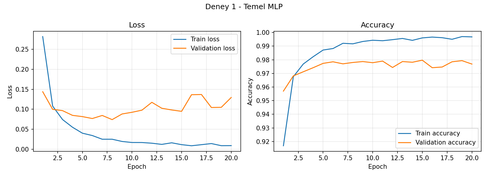
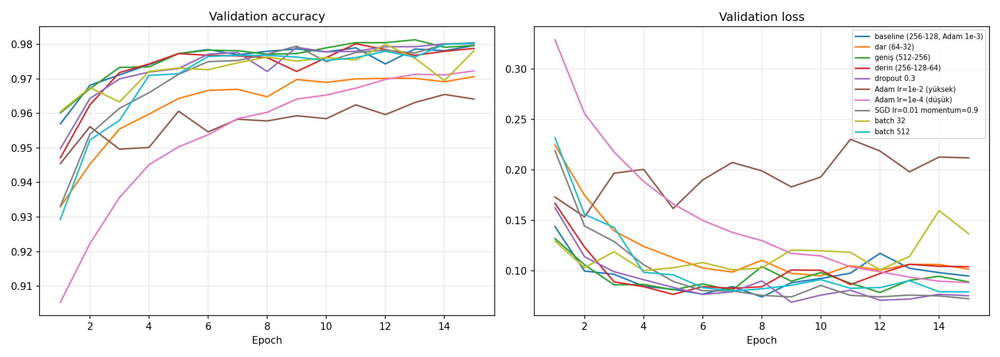
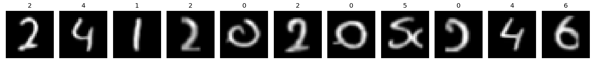
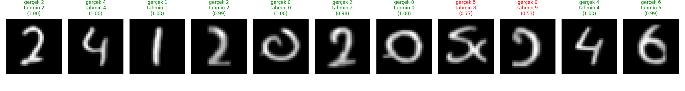

# MNIST ile MLP Tabanlı El Yazısı Rakam Tanıma

Bu projede MNIST veri seti ile **sıfırdan eğitilen bir Multi-Layer Perceptron (MLP)** geliştirilmiş, farklı
hiperparametre/mimari seçimleri karşılaştırılmış ve model **kendi el yazımla yazdığım öğrenci numarası** üzerinde test edilmiştir.
CNN ve hazır eğitilmiş model **kullanılmamıştır** (PyTorch).

- **Öğrenci No:** 24120205046
- **Ad Soyad:** `<BURAYA YAZ>`

## Klasör Yapısı

```
├── src/
│   ├── common.py               # veri bölme, MLP modeli, eğitim/değerlendirme fonksiyonları
│   ├── exp1_baseline.py        # Deney 1: temel MLP
│   ├── exp2_compare.py         # Deney 2: hiperparametre karşılaştırması
│   ├── prepare_handwriting.py  # el yazısı fotoğrafını MNIST formatına çevirir
│   └── eval_handwriting.py     # modeli el yazısı rakamlarda test eder
├── my_handwriting/
│   ├── student_number_original.jpeg  # kendi el yazımla yazdığım öğrenci numarası
│   ├── digits/                       # 28x28 MNIST formatındaki rakamlar (digit_00.png ...)
│   └── preview.png                   # ön işleme kontrol görseli
├── results/                    # grafikler, metrikler, tablolar (kodlar çalıştırılınca oluşur)
├── requirements.txt
└── README.md
```

## Çalıştırma

```bash
pip install -r requirements.txt
python src/prepare_handwriting.py   # el yazısı -> 28x28 MNIST formatı
python src/exp1_baseline.py         # Deney 1 (temel MLP)
python src/exp2_compare.py          # Deney 2 (karşılaştırma + en iyi model seçimi)
python src/eval_handwriting.py      # kendi el yazımda test
```

MNIST ilk çalıştırmada otomatik indirilir (`data/` klasörü).

## Veri Bölme (Train / Validation / Test)

| Küme | Boyut | Kaynak | Kullanım |
|---|---|---|---|
| Train | 54.000 | MNIST eğitim setinin %90'ı (sabit seed ile rastgele) | ağırlıkların öğrenilmesi |
| Validation | 6.000 | MNIST eğitim setinin %10'u | epoch/model/hiperparametre seçimi |
| Test | 10.000 | resmi MNIST test seti | **sadece** final değerlendirme (geliştirme sürecinde kullanılmadı) |

Deney 2'de tüm konfigürasyonlar yalnızca validation başarımına göre karşılaştırılmış; test seti yalnızca seçilen
nihai model için en sonda bir kez kullanılmıştır.

## Deney 1 – Temel MLP

**Mimari:** `784 → 256 → ReLU → 128 → ReLU → 10` (2 hidden layer)

| Hiperparametre | Değer |
|---|---|
| Loss | CrossEntropyLoss |
| Optimizer | Adam |
| Learning rate | 0.001 |
| Batch size | 128 |
| Epoch | 20 (en yüksek validation accuracy'li epoch'un ağırlıkları kullanılır) |
| Dropout / Weight decay | 0 / 0 |
| Normalizasyon | (x/255 − 0.1307) / 0.3081 |
| Seed | 42 |

**Sonuçlar** (`python src/exp1_baseline.py` çıktısından / `results/exp1_metrics.json`):

| Metrik | Değer |
|---|---|
| Training loss | `<DOLDUR>` |
| Validation loss | `<DOLDUR>` |
| Training accuracy | `<DOLDUR>` |
| Validation accuracy | `<DOLDUR>` |
| Test accuracy | `<DOLDUR>` |
| Eğitim süresi | `<DOLDUR>` sn (cihaz: `<CPU/GPU>`) |



## Deney 2 – Konfigürasyon Karşılaştırması

Temel modelden başlayarak her seferinde tek bir şey değiştirilmiştir (15 epoch): katman genişliği, derinlik, dropout,
öğrenme oranı, optimizer (SGD+momentum) ve batch size.

`<results/exp2_results.md içeriğini buraya yapıştır>`



**Seçilen en iyi konfigürasyon:** `<results/exp2_best.json>`  – Test accuracy: `<DOLDUR>`

## Kendi El Yazım ile Test

Öğrenci numaram kareli kağıda mavi tükenmez kalemle yazılıp fotoğraflanmıştır (`my_handwriting/student_number_original.jpeg`).
Ön işleme (`src/prepare_handwriting.py`), görüntüleri MNIST'e benzetmek için şu adımları uygular:

1. Gri kareli kağıt çizgilerinden ayırmak için mavi mürekkep maskelenir (mavi − kırmızı kanal farkı).
2. Bağlı bileşenlerle rakamlar ayrılır; iki vuruşlu rakamlar (ör. `4`) birleştirilir.
3. Gri tonlamalı hale getirilir, **siyah arka plan üzerine beyaz rakam** (MNIST formatı) olacak şekilde ayarlanır.
4. Rakam oranı korunarak 20×20 kutuya sığdırılır, ağırlık merkezine göre 28×28 tuvalin ortasına yerleştirilir.
5. [0,1] aralığına ölçeklenir ve MNIST ile **aynı normalizasyon** uygulanır.



**Model tahmini** (`python src/eval_handwriting.py`):

| | |
|---|---|
| Gerçek numara | 24120205046 |
| Tahmin | `<DOLDUR>` |
| Doğruluk | `<DOLDUR>` / 11 |



## Genel Değerlendirme

> Bu bölümü kendi sonuçlarına bakarak kendi cümlelerinle yaz. Aşağıdaki sorular yol göstericidir.

- Train ve validation loss/accuracy eğrileri nasıl ilerledi? Overfitting belirtisi var mı (train acc ↑, val loss ↑)?
- Test accuracy, validation accuracy ile tutarlı mı? Neden tutarlı olması beklenir?
- Deney 2'de hangi değişiklik başarımı en çok etkiledi (genişlik, derinlik, learning rate, optimizer, batch size, dropout)? Neden?
  Çok yüksek / çok düşük learning rate'te ne gözlendi?
- Eğitim süresi ile başarım arasında nasıl bir denge var?
- Kendi el yazımda başarı MNIST test başarısından neden farklı (distribution shift)? Kalem kalınlığı, rakam stili
  (ör. `0`'ların açık/spiral yazılması, iki vuruşlu `4`), kağıt/ışık ve kırpma-ortalama adımlarındaki hatalar nasıl etkiledi?
  Yanlış tahmin edilen rakamlar hangileri ve model neden karıştırmış olabilir?
- MLP'nin görüntülerde konum/şekil bilgisini neden zor yakaladığı (piksellerin düzleştirilmesi) ve CNN'in neden bu konuda avantajlı olduğu.
